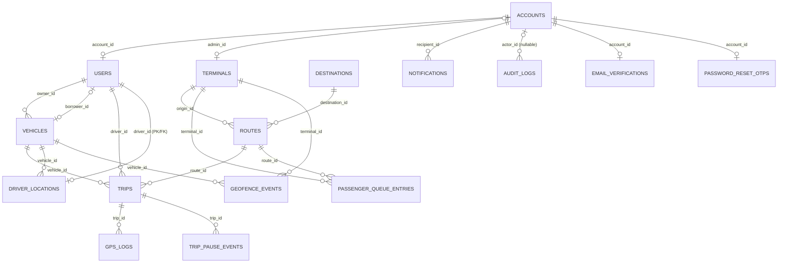

# Entity Relationship Diagram (ERD)

**Document ID:** SRS-ND-DATA-ERD  
**Version:** 1.0  
**Review date:** 2026-10-31  
**Source of truth:** SQLAlchemy models in `backend/app/models` and migrations in `backend/alembic/versions`.

> This ERD describes the current application models in the no-dispatch source. It is not a live database introspection: verify the target PostgreSQL schema and Alembic revision separately. The repository's current Alembic source head is `5a8d2c4f7b91`.

## ERD

## Relationship notes

| Relationship | Cardinality and behavior |
|---|---|
| `accounts` → `users` | One account may have zero or one Driver profile. `users.account_id` is required and unique. Admin accounts have no Driver profile. |
| `accounts` → `terminals` | A terminal may refer to zero or one Admin account; `terminals.admin_id` is nullable and unique. This is a retained terminal-management reference. |
| `users` → `vehicles` as owner | A vehicle has exactly one required canonical owner. `vehicles.owner_id` is not unique in the model, so the database permits an owner to own multiple vehicles. |
| `users` → `vehicles` as borrower | A vehicle may have no borrower or one borrower. `vehicles.borrower_id` is nullable and unique; the borrow relationship references the same vehicle record and does not replace its owner. |
| `users`, `vehicles`, `routes` → `trips` | Each trip requires one Driver, one vehicle, and one route; each referenced record can be used by many trip records over time. |
| `trips` → `gps_logs` | A trip may have zero or many GPS samples. Each sample belongs to exactly one trip. |
| `trips` → `trip_pause_events` | A trip may have zero or many pause/resume events. Deleting a trip cascades to its pause events. |
| `users` → `driver_locations` | Each latest-location row belongs to one Driver. The Driver ID is also the row's primary key, so there is at most one latest-location row per Driver. |
| `routes`, `terminals` → `passenger_queue_entries` | Each anonymous queue session is tied to one route and one terminal. Route/terminal deletion cascades to these entries. |
| `accounts` → `notifications` | An account can receive many persistent notifications; each notification has one recipient. |
| `accounts` → `audit_logs` | An audit event may have no account actor (for example, a system action) or one account actor; an account may produce many audit events. `actor_type` preserves the actor category. |
| `accounts` → OTP tables | Each account may have at most one email-verification row and one password-reset OTP row because each table has a unique `account_id`. Rows cascade-delete with the account. |
| `terminals`, `vehicles` → `geofence_events` | Each event references one terminal and one vehicle; each terminal or vehicle can appear in many events. |

## Tables included

The diagram contains the 16 application tables currently registered by the ORM: `accounts`, `users`, `vehicles`, `terminals`, `destinations`, `routes`, `trips`, `trip_pause_events`, `driver_locations`, `gps_logs`, `passenger_queue_entries`, `notifications`, `audit_logs`, `email_verifications`, `password_reset_otps`, and `geofence_events`.

`alembic_version`, if present in a database, is Alembic's schema-version tracking table and is not an application entity. Dispatch, reservation, ticket, dispatcher, and incident tables are excluded from the current model; historical migrations remain in source to support upgrades from older schemas.

See [Database Matrix](Database%20Matrix.md) for each current model field, type, and purpose.
