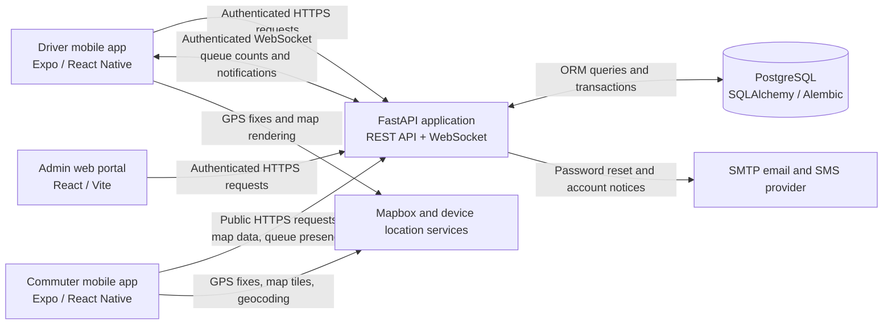
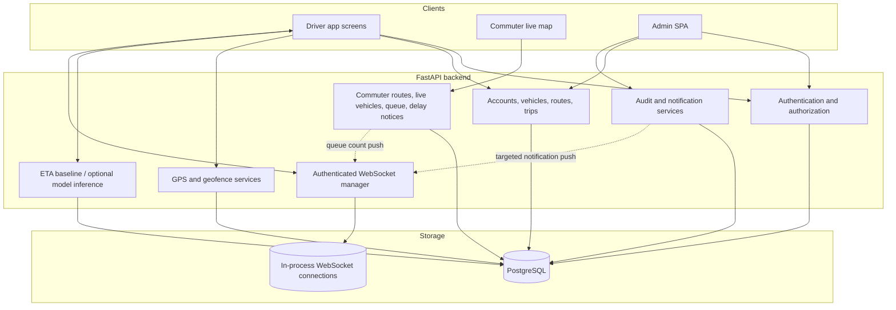

# System Architecture

**System:** Ormoc Transport App  
**Architecture snapshot:** Current no-dispatch system  
**Reviewed:** 20 November 2026

## 1. Purpose and scope

The system provides public-transport route and vehicle visibility to commuters, trip and GPS tools to drivers, and driver-account/vehicle administration with audit review to administrators. The current product consists of two mobile applications, one administrative web application, a FastAPI backend, and a PostgreSQL database.

This document describes the current no-dispatch architecture. Dispatcher and ticketing-officer portals, reservations, dispatch tickets/QR ticketing, and incident-reporting modules are not part of this system version. A driver pause may still create an optional commuter-facing **delay notice**; it is part of trip operations, not an incident-reporting workflow.

## 2. System context

The backend is the shared application boundary. Mobile and web clients communicate with it over HTTPS; the Driver app also opens an authenticated WebSocket for server-pushed events. PostgreSQL is the durable source of truth. The WebSocket connection registry is held in backend process memory and is not a database or shared broker.

## 3. Application components

### 3.1 Driver mobile application

Located in `mobile/driver-app`, the Driver app is an Expo/React Native application using Expo Router for navigation. Its screens and API modules are separated under `src/screens`, `src/app`, and `src/api`; shared authentication, location, and WebSocket behavior is under `src/hooks` and `src/components`.

Current responsibilities include:

- Driver sign-in, sign-out, password reset, and enforced initial password change.
- Driver profile and vehicle information, including editable personal details.
- Route and direction selection, trip start, pause, resume, and completion.
- Foreground GPS capture, current vehicle location updates, and per-trip GPS history.
- Daily trip metrics and trip-history path display.
- Passenger queue count display, using REST refresh and WebSocket updates.
- Delay reason/details submission when a Driver pauses, with an option to broadcast the notice to commuters.

The app uses device location services for GPS, Mapbox for the native map, and secure local storage for authentication/session values. Location permission and device Location Services are separate operating-system states.

### 3.2 Commuter mobile application

Located in `mobile/commuter-app`, this Expo/React Native application uses Expo Router and a native Mapbox map. The current screens include the entrance/introduction flow and live map. The app does not require a commuter account for map viewing or queue presence.

The live map can display active routes and route geometry, latest on-route vehicle positions, the commuter's own device location, approaching-vehicle cues, and active commuter-facing delay notices. A commuter may join a route's passenger-presence queue after the app validates the configured terminal geofence. A locally stored anonymous session token identifies that queue session; it is not a user account, reservation, numbered queue ticket, or passenger identity record.

### 3.3 Admin web portal

Located in `web_ui/web`, the portal is a React single-page application built with Vite and React Router. Its authenticated area contains:

- **Users:** create/manage Driver accounts and related vehicles; suspend/reactivate accounts; edit administrator-controlled Driver/vehicle fields.
- **Audit Logs:** review recorded account and administrative actions.

Protected and public-only route wrappers use the web authentication context. The current Admin portal does not provide live vehicle tracking, trip operations, dispatcher controls, or ticketing.

### 3.4 Backend API

Located in `backend/app`, the backend is a single FastAPI application. `main.py` configures CORS, exception handling, health routes, REST routers, and the WebSocket router. Business logic is organized into SQLAlchemy models, Pydantic schemas, API routers, core authentication/permission helpers, and services.

The active API areas include authentication/accounts, Driver users and vehicles, routes/terminals, trips, GPS, geofencing, commuter public data and passenger presence, notifications, audit logs, and ETA. `/health` and `/` provide basic service checks.

### 3.5 Persistence and migrations

PostgreSQL stores accounts and Driver profiles, vehicles, terminals, destinations and routes, trip records, trip GPS samples, latest Driver/vehicle locations, geofence events, passenger queue sessions, trip pause/delay-notice events, notifications, audit logs, email verification, and password-reset OTP state.

SQLAlchemy models define persistence and relationships. Alembic manages schema evolution. Applying a migration to source code does not update a local or hosted database automatically; each target database must be migrated separately. The database connection is configured through backend environment settings.

## 4. Logical architecture

The API layer validates input with Pydantic schemas, resolves authenticated accounts and role permissions, applies domain rules, and uses SQLAlchemy sessions to read/write PostgreSQL. Services contain reusable work such as audit recording, geofence evaluation, route progress, ETA inference, and outbound email/SMS.

## 5. Key runtime data flows

### 5.1 Authentication and account administration

1. A Driver or Admin submits credentials to the authentication API.
2. The backend verifies credentials and account status/role, then issues the session/access credential used by the client. Browser requests can use the configured HTTP-only cookie; mobile requests use the authorization header and secure local storage.
3. Protected API dependencies resolve the account on each request and enforce active status, required password setup, and role authorization.
4. The Admin portal uses account APIs to create and manage Drivers and their vehicles. The backend records auditable actions and exposes audit records to authorized Admin accounts.
5. Password-reset codes can be delivered through configured email or SMS integrations. Provider availability depends on deployment environment configuration.

### 5.2 Driver trip and GPS recording

1. The Driver selects an active route and chooses `outgoing` or `returning`.
2. The trip API validates the Driver, vehicle, route, and trip state. Outgoing departures use terminal readiness/geofence rules; returning trips may start away from the terminal.
3. During foreground use, the shared location provider sends the latest location for the Driver's current vehicle to the backend. The backend updates the single current-location record and evaluates applicable geofence state.
4. During an active trip, the trip screen separately captures higher-frequency GPS fixes (target interval approximately five seconds) and posts them against the trip. Each accepted sample is stored in the trip GPS history.
5. Pause/resume actions are stored as trip pause events. GPS capture continues during a pause when the app and device can still obtain foreground fixes. A selected pause reason/details can be exposed to commuters when the Driver chooses to broadcast it.
6. At trip completion, the backend records arrival, duration, speed, and filtered distance metrics. The Driver can later retrieve trip details and GPS history for the route overview.

GPS fixes, current location, and trip state are persisted in PostgreSQL. WebSocket messages are not the source of truth for GPS history or commuter map positions.

### 5.3 Commuter live map and vehicle positions

1. The Commuter app requests public route geometry, terminal geofence data, live vehicles, and active delay notices from the backend.
2. Live vehicles are derived from each on-route vehicle's latest stored Driver location and its current trip/route context. The app refreshes live vehicle and delay-notice lists on a periodic HTTP polling interval (currently about ten seconds).
3. The Commuter's own device GPS is used on-device for map position and geofence evaluation. Queue join/heartbeat requests send the needed route and coordinates to the backend.
4. Map tiles and route rendering are provided by the mobile map SDK and configured mapping services; the backend's PostgreSQL data remains the source for application routes and latest vehicle records.

The Admin portal is not a consumer of the live Driver-location stream in the current architecture.

### 5.4 Passenger-presence queue and Driver count updates

1. A Commuter joins a selected route's queue session near the configured terminal geofence. The backend creates or reactivates an anonymous session and returns a session token.
2. While the Commuter remains present, the app sends periodic heartbeats. The backend updates `last_seen_at`; inactive or stale sessions are excluded from the active count according to the queue timeout rule.
3. The Driver app obtains the count for the relevant route using REST and receives count-change events over the authenticated WebSocket when connected.
4. The Driver app also performs periodic REST refresh as a fallback. The displayed value is app-presence count, not a verified count of passengers physically aboard or waiting.

### 5.5 Delay notice visibility

When a Driver pauses a trip, the app may submit a reason and optional details and choose whether to broadcast them. The backend stores the event in the trip's pause history. The Commuter app reads active notices through the public delay-notices API and periodically refreshes them. This is separate from the removed incident-reporting feature.

### 5.6 ETA

The ETA API uses the active trip's latest GPS fix and route geometry to estimate remaining route distance. If a trained model artifact is available and compatible, the backend can load it for inference. Otherwise it returns a clearly labeled distance/speed baseline. A trained, validated production ETA model is not assumed to be present.

## 6. Communication and state ownership

| Data or event | Authoritative owner | Client access pattern |
|---|---|---|
| Accounts, Driver profiles, vehicles, routes, terminals | PostgreSQL via FastAPI | Authenticated REST; public route reads for Commuter |
| Completed/active trips and pause history | PostgreSQL via FastAPI | Authenticated REST |
| Historical trip GPS | `gps_logs` in PostgreSQL | Driver REST upload and own-trip history fetch |
| Latest Driver/vehicle position | `driver_locations` in PostgreSQL | Driver REST update; Commuter public REST polling |
| Anonymous passenger-presence session | PostgreSQL plus client-held session token | Commuter REST join/heartbeat; Driver REST count and WebSocket updates |
| Delay notice | persisted trip pause event | Driver REST write; Commuter REST polling |
| Targeted notifications | PostgreSQL notification record | Authenticated REST list/read and WebSocket push when connected |
| Active WebSocket connections | Backend process memory | Authenticated WebSocket; reconnecting clients fall back to REST where implemented |

WebSocket delivery is best-effort and process-local. Persistent records are read back through REST; WebSocket messages are an update channel, not durable event storage.

## 7. Security and operational boundaries

- Role- and account-status checks are enforced by backend dependencies, not only by hidden client screens.
- Driver trip and GPS endpoints verify the authenticated Driver owns the referenced records.
- Commuter map and queue endpoints intentionally expose only the public data needed for those functions; queue sessions use opaque tokens rather than commuter accounts.
- Secrets, database URLs, API base URLs, Mapbox credentials, CORS origins, and SMTP/SMS settings belong in environment configuration. They must not be embedded in this document or committed as credentials.
- The backend uses a single in-memory WebSocket manager. Multi-worker/multi-instance deployments need a shared event broker or equivalent for cross-process WebSocket delivery.
- The actual hosting topology, database backup schedule, monitoring, TLS termination, and production resource sizing are deployment concerns and are not guaranteed by this source architecture document.

## 8. Current limitations and explicit exclusions

- GPS capture is foreground-focused. Durable offline buffering/replay and guaranteed background tracking are not provided.
- Commuter live vehicle and delay data use periodic HTTP polling rather than a live-map WebSocket subscription.
- Passenger presence is an approximation based on app heartbeats and timeout; it is not confirmed passenger headcount.
- WebSocket connections are in-process and do not coordinate across multiple backend instances.
- ETA may use the baseline unless a suitable trained model artifact is configured; AI/ML model quality is not established by this architecture.
- Dispatch/ticketing, dispatcher workflows, reservation approvals, QR tickets, incident-reporting cases, and the ticketing-officer web portal are excluded from this current system version.

## 9. Source layout reference

| Area | Main path |
|---|---|
| FastAPI application and routers | `backend/app/main.py`, `backend/app/routers/` |
| Models and request/response schemas | `backend/app/models/`, `backend/app/schemas/` |
| Shared business services and security | `backend/app/services/`, `backend/app/core/` |
| Alembic migrations | `backend/alembic/` |
| Driver mobile client | `mobile/driver-app/src/` |
| Commuter mobile client | `mobile/commuter-app/src/` |
| Admin web client | `web_ui/web/src/` |

